# QRPickle

## A lightweight, opinionated, field-friendly HAM Clock

**QRPickle** is a simple, lightweight dashboard designed for portable, QRP, and field-day amateur radio operations. Built to run on a standard ESP32 Cheap Yellow Display (CYD) with no external PSRAM, it consolidates real-time tracking data and tools into a clean, easy-to-use touchscreen interface.

This project is inspired by [cburns42/HamClockCYD](https://github.com/cburns42/HamClockCYD) and [SP3KON/ESP32-HAM-CLOCK](https://github.com/SP3KON/ESP32-HAM-CLOCK), which resulted in a group build at [BARC](https://barc.in/) with VU3GWN forking it to ([coffeedev/BARC-HAM-CLOCK](https://github.com/coffeedev/BARC-HAM-CLOCK)).

**TL;DR:** install QRPickle from your browser with the **[one-click web installer](https://quixotic.bharathpalavalli.com/QRPickle/install/)** (Chrome or Edge, and a USB data cable).

***

### ⚠ DEVELOPED & GENERATED BY A LARGE LANGUAGE MODEL (LLM) ⚠
*This codebase, firmware architecture, network parsing engine, memory management schema, and layout optimization layers were designed, audited, and developed using a Large Language Model (LLM).*

***

## Device Interface

| Boot & Splash | Main Dashboard | App Menu |
| :---: | :---: | :---: |
| 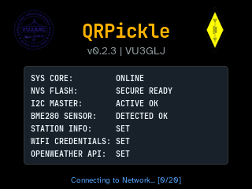 | 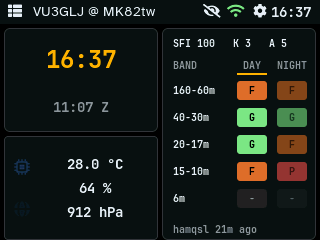 | 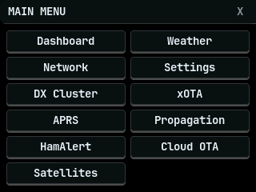 |
| **DX Cluster** | **POTA Spots** | **SOTA Spots** |
| 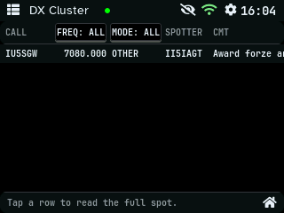 | 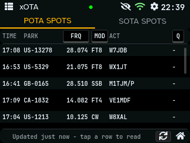 | 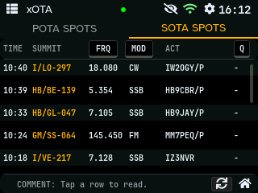 |
| **Band Conditions** | **Solar Indicators** | **Reading the Indicators** |
| 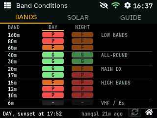 | 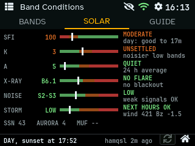 | 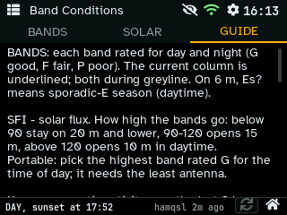 |
| **Satellite Passes** | **A Pass** | **SSTV & School Contacts** |
| 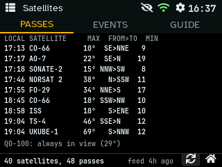 | 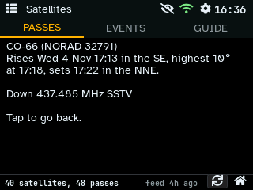 | 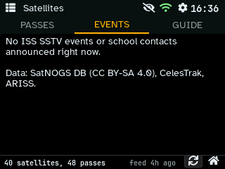 |
| **APRS Traffic** | **APRS Radar** | **APRS Messages** |
| 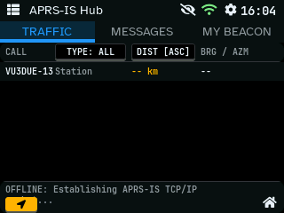 | 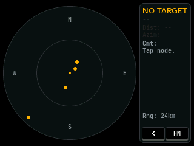 | 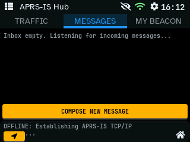 |
| **APRS Quick Messages** | **APRS Beacon** | **HamAlert** |
| 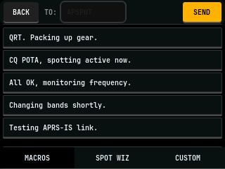 | 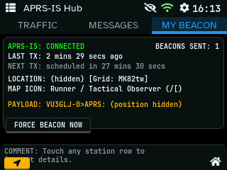 | 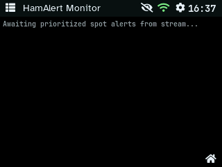 |
| **Local Sensor** | **OpenWeather** | **Forecast** |
| 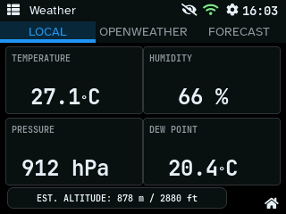 | 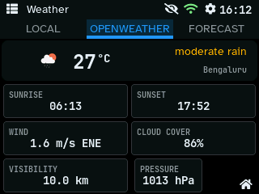 | 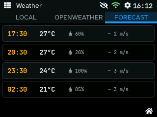 |
| **Network** | **WiFi Scan** | **Cloud Updates** |
| 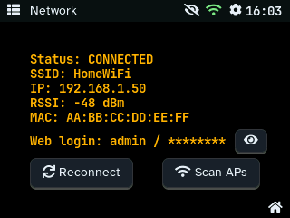 | 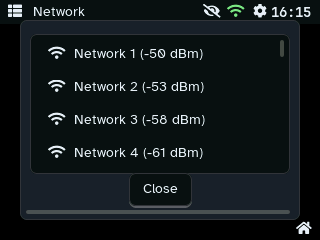 | 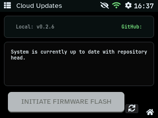 |
| **On-Device Settings** | **On-Screen Keyboard** |   |
| 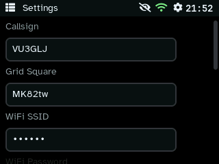 | 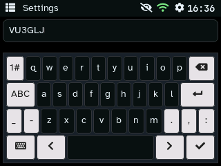 |   |
| **Board Check (first start)** | **Board Doesn't Match the Screen** | **Report an Untested Board** |
| 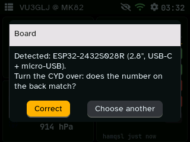 | 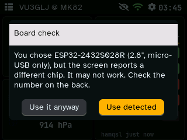 | 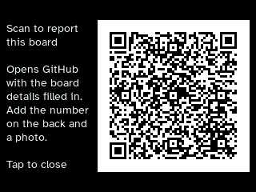 |

Screenshots are taken on the device (`tools/device_screens.py`, Classic theme); network names, addresses and positions are replaced or hidden in them. **Smart sleep:** after the screen timeout the backlight turns off; a touch wakes it (the first touch only wakes).


## Web Management Console

When on the same network, navigate to the device's IP address to access the integrated Web UI. The UI interacts with the C++ backend via asynchronous REST API endpoints.

| Basic Network & Station Config | Advanced Settings |
| :---: | :---: |
| 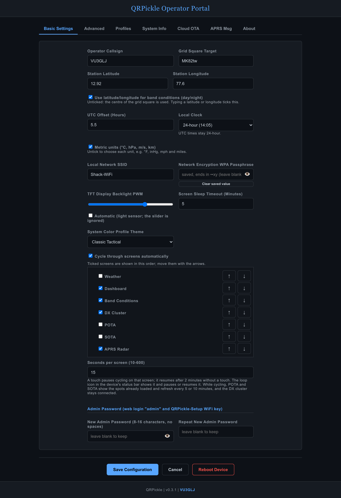 | 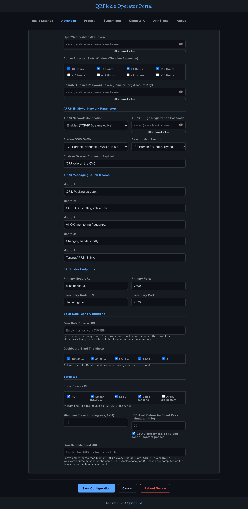 |
| **Profiles, Backup & Restore** | **Editing a Profile in the Settings Form** |
| 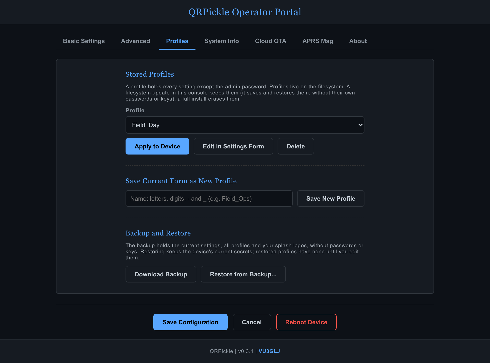 | 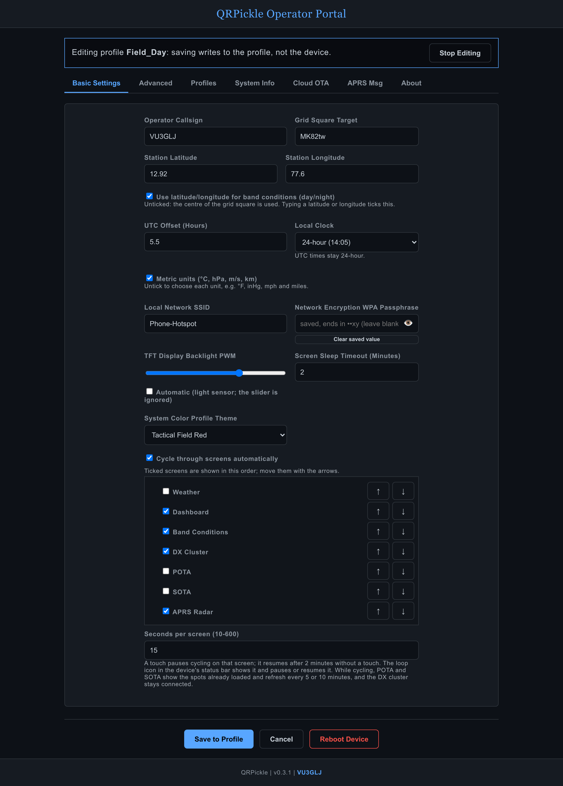 |
| **Live Hardware Telemetry & Manual Update** | **Cloud OTA** |
| 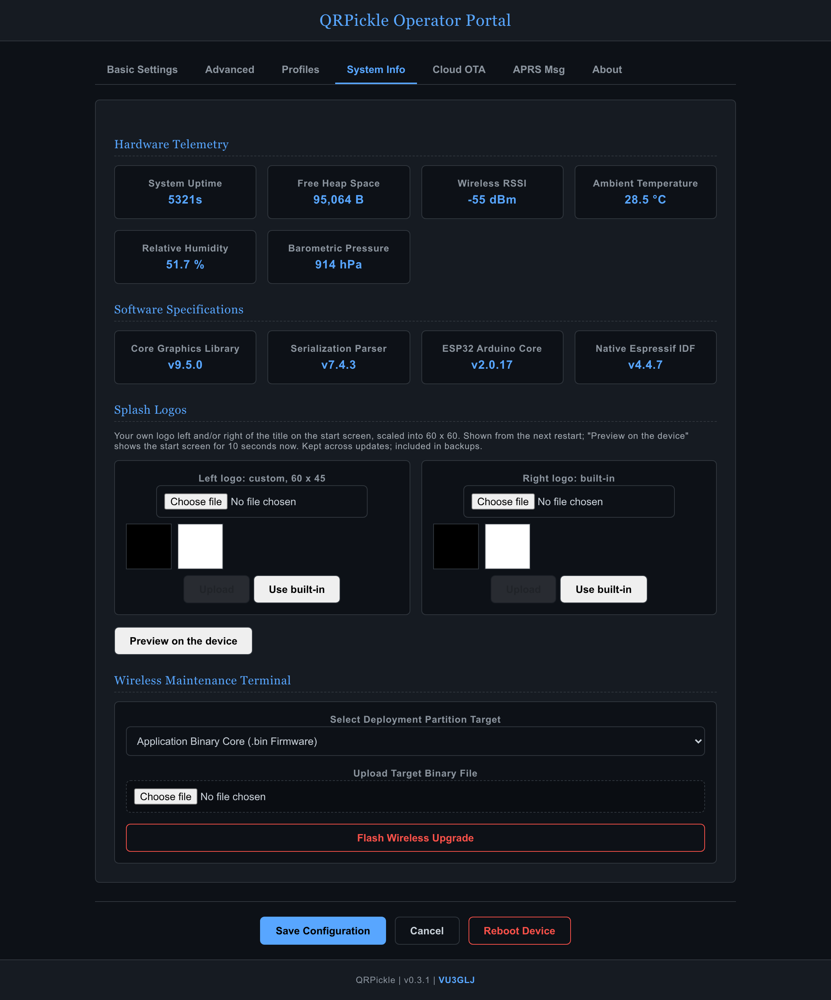 | 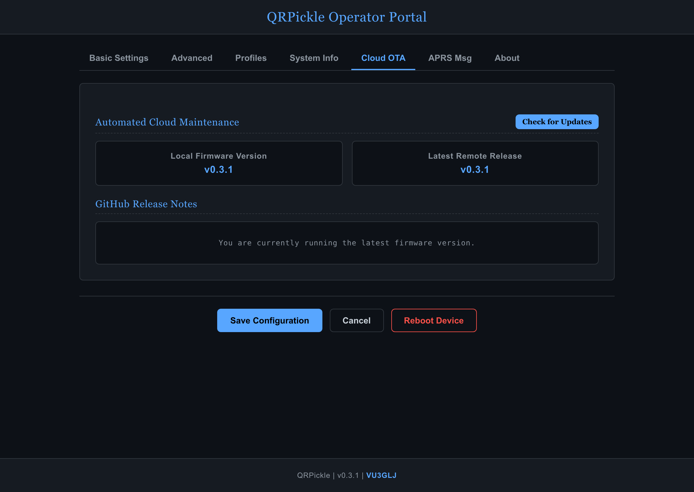 |
| **APRS Messaging** | |
| 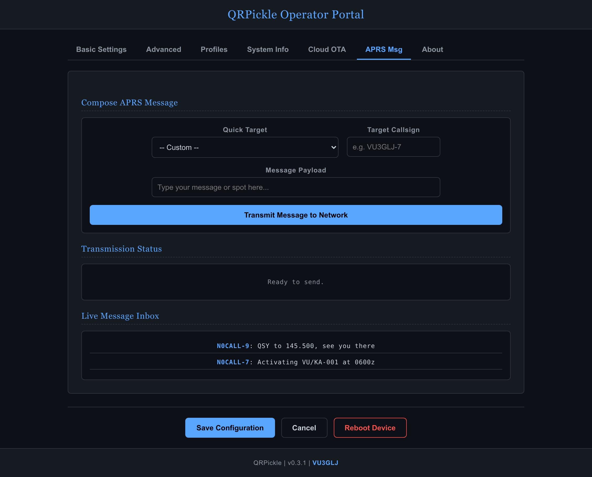 | |


## Web Console Login

The web console and the `QRPickle-Setup` hotspot are password-protected.

- **Username:** `admin`
- **Password:** generated on first boot. It's shown on the device's **Network** screen (the serial boot log masks it). The same password is the WPA2 key for the setup hotspot.
- **Changing it:** Basic Settings → **Admin Password** (8-16 characters, no spaces), then **Save Configuration**. The browser then asks you to log in again, and the setup hotspot uses the new password.

Saved secrets (WiFi password, API keys, passcodes) are never shown again in the web console. Leave those fields blank to keep the stored values.

**Note:** saved profiles store their WiFi credentials on the device's filesystem, so they can switch networks. The flash is not encrypted. A profile without a stored password or key keeps the device's current one when applied. Backups never contain secrets.

## Features and Data Sources

<!-- BEGIN generated: features (scripts/gen_features.py from docs/features.toml) -->
What each screen shows and where its data comes from. Accounts and keys are entered in the web console and stay on the device.

| Screen | What it shows | Data from |
| :--- | :--- | :--- |
| **Dashboard** | Local and UTC time, indoor sensor and weather, band conditions for your chosen band groups | the screens below |
| **DX Cluster** | Live DX spots, filtered by band and mode | DX cluster over telnet (default `dxspider.co.uk:7300`, fallback `dxc.w6bgr.com:7373`; both configurable) |
| **xOTA** | POTA and SOTA activators on air, filtered by band, mode and QRP; says how old the POTA list is | [POTA](https://pota.app) (`api.pota.app`); [SOTA cluster](https://www.sota.org.uk) (`cluster.sota.org.uk`, telnet) |
| **HamAlert** | Spots matching your own triggers | [HamAlert](https://hamalert.org) (your account, telnet) |
| **APRS** | Stations heard (list and radar), messages, your position beacon | [APRS-IS](https://www.aprs-is.net) (`rotate.aprs.net`; your callsign and passcode) |
| **Band Conditions** | 11 bands (160 m to 6 m) rated for day and night at your location, greyline, next sunrise/sunset, solar indicators explained ([how bands are rated](docs/BAND_RATING.md)) | [HAMQSL.com](https://www.hamqsl.com/solar.html) solar data, courtesy of N0NBH (every 3 hours, hourly in storms), or your own source |
| **Satellites** | The next passes over your station of popular amateur satellites (FM, linear, SSTV, voice beacons, optionally APRS) with times, directions and frequencies; ISS SSTV events and ARISS school contacts | A feed built every 6 hours from [SatNOGS DB](https://db.satnogs.org) (CC BY-SA 4.0), [CelesTrak](https://celestrak.org) orbits and [ARISS](https://www.ariss.org) ([about the feed](https://quixotic.bharathpalavalli.com/QRPickle/space/)); passes computed on the device, your location is never sent |
| **Weather** | Indoor temperature, humidity and pressure; current conditions (with their age) and a 24-hour forecast | BME280 sensor (optional, [wiring](docs/HARDWARE.md)); [OpenWeather](https://openweathermap.org) (your free API key) |
| **Network, Settings, Cloud OTA** | WiFi, station and display settings on the device; updates | [GitHub Pages](https://bmp.github.io/QRPickle/ota/ota.json) for updates; time from `pool.ntp.org` |

**On the device**
* **Screen cycling:** chosen screens in turn, in your order (10 s each by default); a touch pauses it, a status-bar icon shows and toggles it.
* **Status LED:** setup and network states, a faint pulse when data arrives, a strobe for HamAlert or APRS messages, and a purple signal before ISS SSTV and school-contact passes ([LED Colours](docs/LEDColours.md)).
* **Themes:** 7 themes in LVGL 9, including Tactical Field Red, Terminal Green and two E-Ink styles.
* **Display:** sleep timeout, manual or automatic brightness (light sensor).
* **Boards:** detects which CYD it runs on, or you choose it. Untested boards ask once for a short report ([board list](docs/BOARDS.md)).
* **Units and clock:** metric by default, or your own choice of °F, inHg, mph, km/h or knots and miles, and a 12- or 24-hour local clock (web console); UTC always stays 24-hour. Accented names (É, ñ, ü) in park, city and event names show as they should.
* **Privacy:** passwords and network details are masked on screen and in the serial log.
* **Splash logos:** your own logos left and right of the title on the start screen (uploaded in the web console, scaled into 60 x 60; kept across updates and in backups; "Preview on the device" shows the start screen for 10 seconds without a restart).

**Web console and updates**
* **Web console:** every setting, profiles (save and switch complete setups for home, mobile and field; download/restore a backup without passwords and keys; a filesystem update keeps profiles and logos; saved secrets show their last 2 characters and can be cleared), APRS messaging and system information. Digest login; the setup hotspot (`192.168.4.1`) takes over when no network is reachable.
* **Set up over USB:** right after installing, the website's [Set up over USB](https://quixotic.bharathpalavalli.com/QRPickle/setup/) page sends your callsign, location, units, WiFi and keys to the board over the USB cable (Chrome or Edge), without joining its hotspot.
* **Updates:** firmware upload in the web console, or **Cloud OTA** from GitHub Pages with a mandatory SHA-256 and verified HTTPS. A new image that doesn't come up healthy within 3 boots is rolled back. First installs: the [web installer](https://quixotic.bharathpalavalli.com/QRPickle/install/).

**How it fits on an ESP32 without PSRAM**
* One network session at a time and streamed JSON parsing keep HTTPS (about 40 KB per session) within memory; long-running work runs in background tasks, never in the UI loop ([memory budget](docs/MEMORY.md)).
* WiFi transmit power is capped (15 dBm) to avoid brownouts on the CYD's regulator.
* Guides for hardware, releasing, debugging and assets: [docs/](docs/README.md).
<!-- END generated: features -->

---

## Time Zone Note

QRPickle uses a fixed UTC offset (in half-hour steps), with no automatic daylight saving. In regions that observe DST, change the offset in Settings twice a year. Most ham-radio activity is logged in UTC, which is always shown correctly.

## Contributing

Bug reports, ideas and pull requests are welcome: see [CONTRIBUTING.md](CONTRIBUTING.md) and the
[Code of Conduct](CODE_OF_CONDUCT.md). Report security problems privately ([SECURITY.md](SECURITY.md)).
What helps with accessibility and what doesn't yet: [ACCESSIBILITY.md](ACCESSIBILITY.md).

## Third-Party Licences

QRPickle's own code is MIT-licensed (see [`License`](License)). The fonts are under the SIL Open Font License 1.1, the web server libraries under LGPL-3.0, and the CYD pinout image in the docs under CC BY-NC-ND 4.0. The full list, with copyright holders and licence texts, is in **[THIRD_PARTY_NOTICES.md](THIRD_PARTY_NOTICES.md)**; each release zip includes it.

## Libraries & Frameworks

The Arduino core, ESP-IDF, LVGL and the other libraries, with their versions and licences, are listed in
[THIRD_PARTY_NOTICES.md](THIRD_PARTY_NOTICES.md).

---

## Partition System & Memory Map

This project utilizes a heavily customized partition table (`partitions.csv`) to fit a complex FreeRTOS application, LVGL graphics, a Web UI, and an Over-The-Air (OTA) update system into a standard 4MB ESP32 flash chip.

The full flash map, from the start of the chip. The bootloader and the partition table sit at fixed addresses before the first partition; the rest comes from `partitions.csv`:

<!-- BEGIN generated: partitions (scripts/gen_flash_docs.py from partitions.csv) -->
| Address | Region | Size | Contents | Written at install |
| :--- | :--- | :--- | :--- | :--- |
| `0x001000` | Bootloader |  | ESP32 second-stage bootloader | `bootloader.bin` |
| `0x008000` | Partition table |  | The table below | `partitions.bin` |
| `0x009000` | **`nvs`** | `0x005000` (20 KB) | Settings: WiFi, callsign, keys, admin password | Kept (cleared only by "Erase device") |
| `0x00E000` | **`otadata`** | `0x002000` (8 KB) | Which app slot boots (`app0` or `app1`) | `boot_app0.bin` (boot `app0`) |
| `0x010000` | **`app0`** | `0x1C0000` (1.75 MB) | Firmware slot 1 | `firmware.bin` |
| `0x1D0000` | **`app1`** | `0x1C0000` (1.75 MB) | Firmware slot 2: updates (web upload or Cloud OTA) are written to whichever slot isn't running, so a failed update can roll back | Not written |
| `0x390000` | **`spiffs`** | `0x070000` (448 KB) | LittleFS: web console (`www/`), images, about text, saved profiles | `littlefs.bin` |
<!-- END generated: partitions -->

The installer and the manual flashing steps below use exactly these addresses for every version. Changing `partitions.csv` breaks OTA for devices already in use.

---

## Production Pipeline & Flashing

The project is built entirely within **PlatformIO** (VS Code).

### 1. Pre-Flight Setup
Supported boards (no soldering needed). What else you need (USB cable, the optional BME280 sensor) and the wiring are in **[Hardware and Wiring](docs/HARDWARE.md)**.

<!-- BEGIN generated: boards (scripts/gen_boards.py from boards/boards.toml) -->
| Board (number on the back) | Screen | Touch | Status |
|---|---|---|---|
| ESP32-2432S028R (2.8", USB-C + micro-USB) | 320 x 240 | resistive | **tested** |
| ESP32-2432S028R (2.8", micro-USB only) | 320 x 240 | resistive | untested |
| ESP32-2432S028R (2.8", USB-C + micro-USB, ST7789 screen) | 320 x 240 | resistive | untested |
| ESP32-2432S024R (2.4") | 320 x 240 | resistive | untested |
| ESP32-2432S024C (2.4") | 320 x 240 | not supported yet | untested |
| ESP32-2432S032R (3.2") | 320 x 240 | resistive | untested |
| ESP32-2432S032C (3.2") | 320 x 240 | capacitive | untested |
| ESP32-3248S035R (3.5") | 480 x 320 | resistive | untested |
| ESP32-3248S035C (3.5") | 480 x 320 | capacitive | untested |
| JC2432W328C (2.8", Guition, capacitive touch) | 320 x 240 | not supported yet | untested |

Pins, connectors and sources for each board: [board list](docs/BOARDS.md).
<!-- END generated: boards -->

### 2. Uploading the Filesystem (Web UI & Profiles)
Before the firmware will function fully (especially the Web UI), you must write the `data/` folder to the LittleFS partition.
```bash
pio run --target uploadfs
```
**Warning:** writing the filesystem (by USB, web upload or web installer) replaces the whole LittleFS partition, which **erases saved profiles**. Settings stored in NVS (WiFi, callsign, keys, admin password) are kept, unless you tick "Erase device" in the web installer.

### 3. Compiling and Flashing the Core Firmware
Compile the C++ source and burn the binary to the ESP32 via USB.
```bash
pio run --target upload
```

### 4. Over-The-Air (OTA) Updates
Once deployed in the field, further updates can be pushed wirelessly. Compile your firmware in PlatformIO to generate `firmware.bin` or `littlefs.bin`, open the System Info tab on the Web UI, and push the payload directly over your local network.

Designed for operational reliability out in the field. Keep the signal clean, the power consumption managed, and the heap layout stable. 73!

---

## Downloading Pre-Compiled Releases

You do not need to install VS Code or PlatformIO to use QRPickle. Pre-compiled binaries for the CYD are available in the repository releases.

**[Download the latest release binaries](https://github.com/bmp/QRPickle/releases/latest)** (every release also lists `firmware.bin.sha256` for integrity checks)

The release folder contains the following files:
* `firmware.bin` (The core C++ application)
* `littlefs.bin` (The Web UI and filesystem data)
* `bootloader.bin` & `partitions.bin` (Low-level ESP32 boot structures)
* `License`, `THIRD_PARTY_NOTICES.md` and the font licences (`OFL-*.txt`) (in the ZIP)
* `boot_app0.bin` (marks the first app slot as the one to start)

**Flashing from a terminal** (when a browser can't connect): install
`esptool` (`pipx install esptool`, or use PlatformIO's copy), connect the CYD and run, from the folder with
the downloaded files:

```bash
# Firmware only: settings, profiles and the web console files stay
esptool --chip esp32 --port /dev/ttyUSB0 write_flash 0xe000 boot_app0.bin 0x10000 firmware.bin
# Everything (a new board); add "erase_flash" first for a clean start, which also clears settings
esptool --chip esp32 --port /dev/ttyUSB0 write_flash 0x1000 bootloader.bin 0x8000 partitions.bin \
  0xe000 boot_app0.bin 0x10000 firmware.bin 0x390000 littlefs.bin
```

The port is `/dev/ttyUSB0` on Linux, `/dev/cu.usbserial-…` on macOS, `COM3` (or similar) on Windows. Older
`esptool` versions are called `esptool.py`.

**Web installer on Linux.** Chromium 154 on Linux (seen with the Flatpak and Fedora builds) doesn't set the serial
port's speed: the port keeps its previous speed, 9600 after plugging in, and the installer reports "Failed to
initialize". Run `stty -F /dev/ttyUSB0 115200` before installing, or set it automatically whenever a CH340 board
is plugged in with a udev rule (`/etc/udev/rules.d/99-ch340.rules`, then `sudo udevadm control --reload-rules`
and replug):

```
SUBSYSTEM=="tty", ATTRS{idVendor}=="1a86", ATTRS{idProduct}=="7523", MODE="0660", TAG+="uaccess", RUN+="/usr/bin/stty -F /dev/%k 115200"
```

Then hold **BOOT** while clicking Install and release it once installing starts (the browser can't switch the CYD
into download mode by itself there). Other Chromium-based browsers on Linux may behave the same.

---

## Easy Web Installation (No Software Required)

**One-click installer (from v0.2.0):** open **[quixotic.bharathpalavalli.com/QRPickle/install](https://quixotic.bharathpalavalli.com/QRPickle/install/)** in Chrome or Edge, pick a version (the latest is preselected; the last five releases are listed), connect the CYD by USB and click **Install**. It writes everything, including the filesystem. If you're updating a device that already has profiles, download a backup first (web console → Profiles → Download Backup).

**Manual alternative:** flash the release files with the Espressif Web Flasher.

1. Connect your CYD to your computer via USB.
2. Open the **[Espressif Web Flasher Tool](https://espressif.github.io/esptool-js/)**.
3. Set your baud rate to `921600` and click **Connect**.
4. Add the release files to the flash tool using their exact partition offsets:
   <!-- BEGIN generated: flash offsets (scripts/gen_flash_docs.py from partitions.csv) -->
   * **`0x1000`** ➔ `bootloader.bin`
   * **`0x8000`** ➔ `partitions.bin`
   * **`0xE000`** ➔ `boot_app0.bin`
   * **`0x10000`** ➔ `firmware.bin`
   * **`0x390000`** ➔ `littlefs.bin`
   <!-- END generated: flash offsets -->
5. Click **Program** and wait for the process to finish. The device will automatically reboot into QRPickle!
6. And the device should boot up, and create a WiFi access-point called `QRPickle-Setup` protected with the admin password shown on the device's **Network** screen (see [Web Console Login](#web-console-login)).
