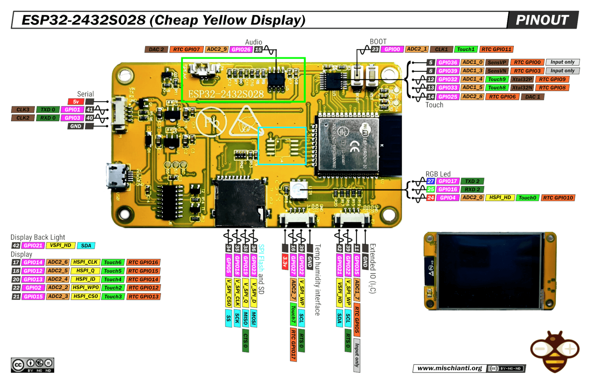

# Hardware and Wiring

QRPickle runs on the **"Cheap Yellow Display" (CYD)** family (boards and their status: table below). Nothing needs soldering. The only optional extra is a **BME280** sensor for indoor temperature, humidity and pressure.

## What you need

| Part | Needed? | Notes |
|---|---|---|
| A CYD board from the table below | yes | check the number printed on the back |
| USB **data** cable | yes | some cables only charge; on some two-port boards the USB-C port needs a USB-A to USB-C cable |
| BME280 sensor module (3.3 V, I2C, 4 pins) | optional | indoor temperature, humidity and pressure on connector CN1 ([wiring](#optional-bme280-sensor)); **not a BMP280** (no humidity) |
| 4-pin JST 1.25 mm cable | with the BME280 | often in the box with the CYD |
| Battery, charger, GPS, RTC, battery monitor | planned for v0.4 | the portable station: not supported yet |

Electronics shops that sell ESP32 boards carry these parts. Go by the number on the back of the board, not the shop's title.

## Boards

<!-- BEGIN generated: boards (scripts/gen_boards.py from boards/boards.toml) -->
| Board (number on the back) | Screen | Touch | Status |
|---|---|---|---|
| ESP32-2432S028R (2.8", USB-C + micro-USB) | 320 x 240 | resistive | **tested** |
| ESP32-2432S028R (2.8", micro-USB only) | 320 x 240 | resistive | untested |
| ESP32-2432S028R (2.8", USB-C + micro-USB, ST7789 screen) | 320 x 240 | resistive | untested |
| ESP32-2432S024R (2.4") | 320 x 240 | resistive | untested |
| ESP32-2432S024C (2.4") | 320 x 240 | not supported yet | untested |
| ESP32-2432S032R (3.2") | 320 x 240 | resistive | untested |
| ESP32-2432S032C (3.2") | 320 x 240 | capacitive | untested |
| ESP32-3248S035R (3.5") | 480 x 320 | resistive | untested |
| ESP32-3248S035C (3.5") | 480 x 320 | capacitive | untested |
| JC2432W328C (2.8", Guition, capacitive touch) | 320 x 240 | not supported yet | untested |

Pins, connectors and sources for each board: [board list](BOARDS.md).
<!-- END generated: boards -->

## Board pinout



*"ESP32-2432S028 (Cheap Yellow Display) pinout" by Renzo Mischianti, from [ESP32-2432S028 (Cheap Yellow Display): high-resolution pinout, datasheet, schema and specs](https://mischianti.org/esp32-2432s028-cheap-yellow-display-high-resolution-pinout-datasheet-schema-and-specs/) on [mischianti.org](https://www.mischianti.org). Licensed under [CC BY-NC-ND 4.0](https://creativecommons.org/licenses/by-nc-nd/4.0/); reproduced unmodified. This image is not covered by QRPickle's MIT licence (see [third-party images](pics/third-party/README.md)).*

The BME280 connector is the one labelled **"Temp humidity interface"** (CN1) at the bottom of the image.

> This page describes the 2.8" board. Other boards have different pins: see the [board list](BOARDS.md). On them the BME280 sensor isn't supported yet.

## The board

The reference CYD (checked with `esptool flash_id` and the boot log):

| Item | Value |
|---|---|
| Chip | ESP32-D0WD-V3 (revision v3.1), dual core, 240 MHz, WiFi + Bluetooth |
| Flash | 4 MB |
| PSRAM | none |
| Display | 2.8" ILI9341, 320 x 240 |
| Touch | XPT2046, resistive |

## Pins QRPickle uses

These come from `src/hw/User_Setup.h`, `src/hw/touch.cpp`, `src/hw/sensor.cpp`, `src/hw/led_rgb.cpp` and `src/services/display_manager.cpp`.

| Function | GPIO | Notes |
|---|---|---|
| Display SPI | MISO 12, MOSI 13, SCLK 14, CS 15, DC 2 | Reset is wired to 3.3V on the board |
| Display backlight | 21 | PWM; also appears on connector P3, so don't use it there |
| Touch SPI | MOSI 32, MISO 39, CLK 25, CS 33 | Separate SPI bus |
| Light sensor (LDR) | 34 (ADC1 channel 6) | Auto-brightness |
| RGB status LED | R 4, G 16, B 17 | Active low; colours: [LEDColours.md](LEDColours.md) |
| **BME280 (I2C)** | **SDA 27, SCL 22** | Optional, on connector **CN1** |

The micro-SD slot and the speaker connector are not used.

## Optional BME280 sensor

The dashboard and weather screen show indoor temperature, humidity and pressure from a BME280 connected to **CN1**, the small 4-pin socket on the board's edge. Without a sensor, QRPickle shows `--` for these values.

### Wiring

| CN1 signal (printed on the board) | BME280 pin |
|---|---|
| GND | GND |
| IO22 (GPIO22) | SCL |
| IO27 (GPIO27) | SDA |
| 3.3V | VIN / VCC |

```
   CYD connector CN1               BME280 module
  +--------+                      +-----------+
  |  GND   |----------------------| GND       |
  |  IO22  |----------------------| SCL       |
  |  IO27  |----------------------| SDA       |
  |  3.3V  |----------------------| VIN / VCC |
  +--------+                      +-----------+
```

Match the wires by the labels printed next to CN1, not by position or colour. The pin order looks reversed depending on which side you view the board from (the pinout image shows 3.3V, 27, 22, GND from left to right), and cable colours vary.

### Notes

- **Use 3.3V.** CN1 provides 3.3V. Most breakout modules accept it on VIN.
- **Address:** QRPickle tries both I2C addresses, `0x76` and `0x77`, so either SDO setting works.
- **6-pin modules** (with CSB and SDO): connect CSB to 3.3V to select I2C mode. SDO selects the address (GND = 0x76, 3.3V = 0x77).
- **BMP280 is not a BME280.** Many cheap modules sold as "BME/BMP280" carry a BMP280, which has no humidity sensor. QRPickle doesn't detect a BMP280 and shows the sensor as offline.
- **Detection happens at boot.** Power-cycle the CYD after connecting the sensor.

### Checking it works

- On the device, the dashboard shows the indoor values instead of `--`.
- In the web console, **System Info** shows the temperature, and `/api/status` reports `"sensor_online": true`.

## Power

Power the CYD from a 5V USB supply through the micro-USB socket. The firmware limits WiFi transmit power to avoid brown-outs on the board's 3.3V regulator. If the board resets during WiFi activity, try a better cable or supply first.
